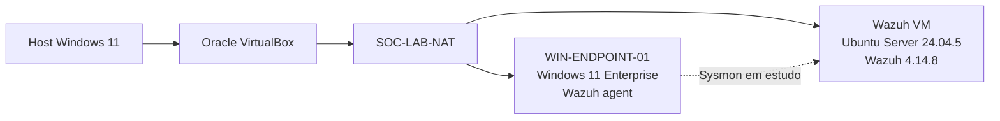

# OpenSOC Lab

> Open Source Detection Engineering & Threat Hunting Laboratory

O OpenSOC Lab é um laboratório doméstico de defesa cibernética construído para estudar, com evidências reproduzíveis, como telemetria de endpoints se transforma em detecção, investigação e resposta.

O ambiente já possui um núcleo Wazuh e um endpoint Windows em máquinas virtuais. O trabalho atual está concentrado em compreender e validar o Sysmon antes de adotar configurações comunitárias ou criar regras próprias.

## Estado atual

| Componente | Estado |
| --- | --- |
| VirtualBox e rede `SOC-LAB-NAT` | Operacionais |
| Wazuh 4.14.8 all-in-one | Instalado |
| `WIN-ENDPOINT-01` | Agente Wazuh ativo |
| Sysmon | Estudo da configuração em andamento |
| LAB-0001 | Evidência documental pendente |
| LAB-0002 | Planejado |

## Arquitetura atual



## Onde começar

- [Abrir a wiki](docs/index.md)
- [Entender o projeto](docs/project/project-guide.md)
- [Consultar o inventário real](docs/infrastructure/virtualbox-inventory.md)
- [Acompanhar o roadmap](docs/project/roadmap.md)
- [Ler o diário técnico](docs/journal/index.md)
- [Estudar o Sysmon](docs/tools/sysmon/index.md)

## Organização

- `docs/`: wiki publicada pelo MkDocs.
- `labs/`: experimentos e critérios de validação.
- `configs/`: configurações sanitizadas e versionáveis.
- `detections/`: regras Sigma e YARA.
- `playbooks/`: procedimentos operacionais.
- `scripts/`: automações e analisadores locais.
- `templates/`: padrões para novos artefatos.

## Executar a wiki localmente

```powershell
python -m venv .venv
.\.venv\Scripts\Activate.ps1
pip install -r requirements-docs.txt
mkdocs serve
```

Depois acesse `http://127.0.0.1:8000`.

## Princípios

- Telemetria antes da detecção.
- Hipótese antes da consulta.
- Evidência antes da conclusão.
- Segurança e autorização em todos os testes.
- Nenhuma credencial, chave ou dado pessoal no Git.

## Licença e colaboração

Consulte [CONTRIBUTING.md](CONTRIBUTING.md), [SECURITY.md](SECURITY.md) e a [MIT License](LICENSE).
