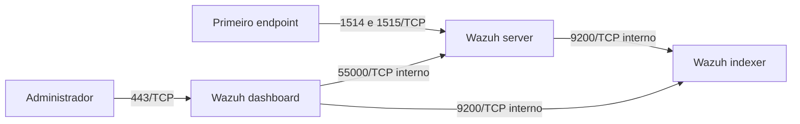

# Plano de rede do núcleo Wazuh

## Fluxos mínimos propostos

| Origem | Destino | Porta | Finalidade | Exposição |
| --- | --- | --- | --- | --- |
| Endpoint | Wazuh server | 1514/TCP | Eventos do agente | Somente rede monitorada |
| Endpoint | Wazuh server | 1515/TCP | Enrollment | Temporária ou restrita |
| Administrador | Wazuh dashboard | 443/TCP | Interface web | Somente gerenciamento |
| Dashboard | Wazuh server | 55000/TCP | API | Interna |
| Wazuh server | Wazuh indexer | 9200/TCP | Indexação | Interna no all-in-one |

Portas de cluster, syslog e integrações permanecem fechadas enquanto não houver caso de uso. No modo all-in-one, `9200/TCP` e `55000/TCP` não devem ser publicados para redes de usuários.

## Validação

As regras de firewall devem ser testadas da origem real. Um teste de porta confirma conectividade TCP, não autenticação nem funcionamento do serviço.
