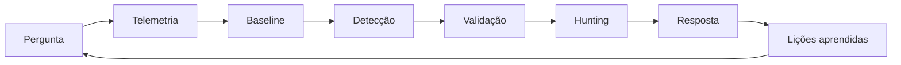

# Wiki do OpenSOC Lab

Esta wiki é a fonte central de conhecimento do projeto. Ela reúne arquitetura, inventário, decisões, ferramentas, laboratórios, releases e o histórico de aprendizado sem transformar o README em um manual gigantesco.

## O projeto em uma frase

Um laboratório Open Source para aprender como eventos produzidos por Windows e Linux percorrem sensores, coleta, análise, detecção, investigação e resposta.

## Situação em 17 de novembro de 2026

| Área | Situação | Próxima evidência |
| --- | --- | --- |
| Infraestrutura | Duas VMs em VirtualBox e rede NAT dedicada | Exportar inventário pelo `VBoxManage` |
| Wazuh | 4.14.8 instalado e agente Windows ativo | Documentar versões e executar LAB-0001 |
| Sysmon | XML didático em estudo | Confirmar versão/schema e corrigir semântica dos filtros |
| Detecções | Estrutura criada | Validar campos reais antes da primeira regra Sigma |
| Linux/NSM/CTI/DFIR | Planejados | Seguir o roadmap por releases |

## Mapa da wiki

### Entender o projeto

- [Guia completo do projeto](project/project-guide.md)
- [Filosofia](project/lab-philosophy.md)
- [Arquitetura](project/architecture.md)
- [Roadmap](project/roadmap.md)
- [Stack tecnológico](project/technology-stack.md)
- [Estrutura do repositório](project/structure.md)

### Conhecer o ambiente real

- [Inventário do VirtualBox](infrastructure/virtualbox-inventory.md)
- [Topologia e rede](infrastructure/topology.md)
- [Avaliação do host](getting-started/host-assessment.md)
- [Plano de rede do Wazuh](architecture/network-plan.md)

### Estudar as ferramentas

- [Wazuh](tools/wazuh/index.md)
- [Sysmon](tools/sysmon/index.md)
- [Anatomia do `sysmonconfig.xml`](tools/sysmon/configuration.md)
- [Integração Sysmon e Wazuh](tools/sysmon/wazuh-integration.md)

### Acompanhar e reproduzir

- [Releases](releases/0.2.0.md)
- [Architecture Decision Records](adr/index.md)
- [Como executar um laboratório](guides/running-a-lab.md)
- [Diário técnico](journal/index.md)
- [Glossário](reference/glossary.md)
- [Referências](reference/references.md)

## Fluxo de aprendizado

!!! warning "Ambiente autorizado"
    Execute testes somente em sistemas próprios ou explicitamente autorizados. O laboratório deve permanecer separado de ambientes corporativos e de produção.

!!! info "Documentação versus evidência"
    Uma configuração observada em captura é inventário. Um componente “ativo” relatado é estado informado. Uma release só é concluída quando os critérios são comprovados e registrados.
