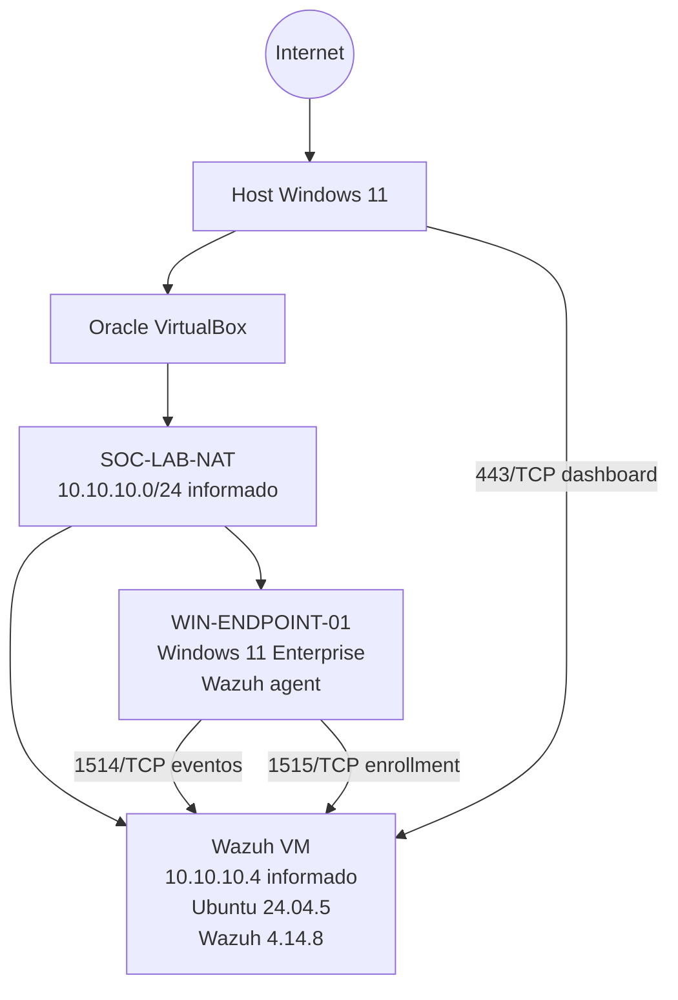

# Topologia atual

## Visão lógica

## Limites de confiança

- Nomes, recursos e tipo de rede foram observados nas capturas.
- Versões, IPs e estado do agente vêm do histórico compartilhado.
- Conectividade atual não foi retestada nesta sessão.
- A arquitetura futura com Linux endpoint, Zeek, Suricata, MISP e Velociraptor não faz parte desta topologia atual.

## Riscos conhecidos

- As duas VMs competem por recursos com o host de aproximadamente 16 GiB de RAM.
- O núcleo Wazuh possui 4 GiB, abaixo da referência inicial usada no planejamento.
- O disco Wazuh já ocupava 36,65 GB físicos no momento da captura.
- A ISO do Windows permanecia montada no endpoint.
- Ambos os discos virtuais estavam sem criptografia no VirtualBox.

Esses itens devem ser avaliados, não corrigidos automaticamente: laboratório, desempenho, recuperação e exposição pública têm requisitos diferentes.
