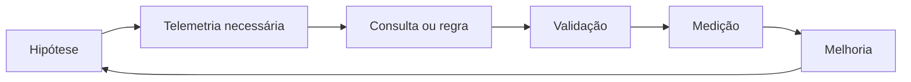

# Visão geral

O OpenSOC Lab é simultaneamente ambiente de estudos, documentação técnica e portfólio público. Seu foco não é acumular ferramentas, mas demonstrar o ciclo completo entre uma pergunta defensiva e uma resposta verificável.

## Ciclo de trabalho

Cada resultado deve responder: qual comportamento se deseja observar, qual fonte contém a evidência, como a lógica foi testada e quais condições limitam sua eficácia.
