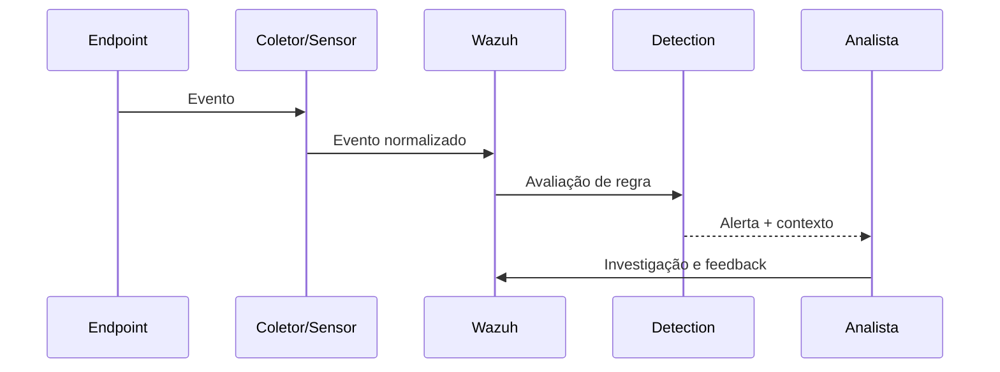

# Arquitetura

## Visão lógica

O laboratório será dividido em cinco planos:

1. **Fontes:** Windows, Linux, serviços e tráfego de rede.
2. **Sensores:** Sysmon, auditd, Zeek e Suricata.
3. **Coleta e análise:** agentes e servidor Wazuh.
4. **Contexto e investigação:** MISP e Velociraptor.
5. **Consumo:** dashboards, hunts, playbooks e relatórios.

## Zonas de rede

- **Management:** administração e acesso aos painéis.
- **Monitored:** endpoints e serviços observados.
- **Sensors:** interfaces e serviços de monitoramento.
- **Attack simulation:** origem isolada de testes autorizados.

Separação física ou VLANs será escolhida conforme os recursos disponíveis. Nenhum serviço administrativo deve ser publicado diretamente na Internet.

## Fluxo de dados

## Requisitos não funcionais

- Horário sincronizado por NTP e armazenado preferencialmente em UTC.
- TLS em integrações que atravessam a rede.
- Backup das configurações e documentação do processo de restauração.
- Retenção dimensionada depois de medir o volume real.
- Identificação consistente de hosts e fontes.

Detalhes evolutivos ficam em `docs/architecture/` e decisões em `docs/adr/`.
