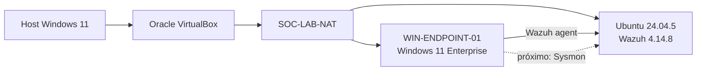

---
hide:
  - toc
---

# Relatório de evolução

Uma visão executiva e verificável do OpenSOC Lab: o que existe, quanto avançou e qual é o próximo experimento.

  Atualizado em <strong>17 nov. 2026</strong>
  Release ativa <strong>0.3.0</strong>
  Ambiente <strong>Home Lab</strong>

## Visão geral

  <article class="metric-card">
    Arquivos do projeto
    <strong class="metric-value">76</strong>
    estrutura, documentação e automação
  </article>
  <article class="metric-card">
    Documentos Markdown
    <strong class="metric-value">66</strong>
    wiki, laboratórios e governança
  </article>
  <article class="metric-card">
    Máquinas virtuais
    <strong class="metric-value">2</strong>
    núcleo Wazuh + endpoint Windows
  </article>
  <article class="metric-card">
    ADRs
    <strong class="metric-value">4</strong>
    decisões arquiteturais registradas
  </article>

## Evolução do repositório

  

    

      <h3>Arquivos por marco</h3>
      
Crescimento acumulado registrado durante a construção.

    

    +77%
  

  

    <svg class="line-chart" viewBox="0 0 760 280" role="img" aria-labelledby="files-chart-title files-chart-desc">
      <title id="files-chart-title">Evolução dos arquivos do projeto</title>
      <desc id="files-chart-desc">43 arquivos na fundação, 55 no planejamento Wazuh, 57 após avaliação do host, 69 no início do Sysmon, 72 após a criação da wiki e 76 no relatório web.</desc>
      <g class="chart-grid">
        <line x1="70" y1="40" x2="720" y2="40" />
        <line x1="70" y1="95" x2="720" y2="95" />
        <line x1="70" y1="150" x2="720" y2="150" />
        <line x1="70" y1="205" x2="720" y2="205" />
      </g>
      <g class="chart-axis-labels">
        <text x="30" y="45">80</text><text x="30" y="100">65</text>
        <text x="30" y="155">50</text><text x="30" y="210">35</text>
      </g>
      <path class="chart-area" d="M90 176 L214 132 L338 125 L462 81 L586 70 L710 55 L710 225 L90 225 Z" />
      <polyline class="chart-line" points="90,176 214,132 338,125 462,81 586,70 710,55" />
      <g class="chart-points">
        <circle cx="90" cy="176" r="6" /><circle cx="214" cy="132" r="6" />
        <circle cx="338" cy="125" r="6" /><circle cx="462" cy="81" r="6" />
        <circle cx="586" cy="70" r="6" /><circle cx="710" cy="55" r="6" />
      </g>
      <g class="chart-values">
        <text x="90" y="158">43</text><text x="214" y="114">55</text>
        <text x="338" y="107">57</text><text x="462" y="63">69</text>
        <text x="586" y="52">72</text><text x="710" y="37">76</text>
      </g>
      <g class="chart-x-labels">
        <text x="90" y="252">Fundação</text><text x="214" y="252">Wazuh</text>
        <text x="338" y="252">Host</text><text x="462" y="252">Sysmon</text>
        <text x="586" y="252">Wiki</text><text x="710" y="252">Site</text>
      </g>
    </svg>
  

## Progresso por release

Percentuais editoriais baseados nos critérios documentados; não são métricas automáticas do ambiente.

  <article class="release-card">
    
<strong>0.1.0 · Fundação</strong>100%

    

    
Governança, arquitetura, MkDocs, ADRs e templates.

  </article>
  <article class="release-card">
    
<strong>0.2.0 · Wazuh</strong>80%

    

    
Instalação e agente ativos; faltam inventário exportado e LAB-0001.

  </article>
  <article class="release-card">
    
<strong>0.3.0 · Sysmon</strong>35%

    

    
Base teórica pronta; XML real, baseline e LAB-0002 pendentes.

  </article>

## Estado dos componentes

  
<strong>VirtualBox</strong>Operacional

  
<strong>Wazuh 4.14.8</strong>Instalado

  
<strong>Wazuh agent</strong>Ativo conforme histórico

  
<strong>Sysmon</strong>Em estudo

  
<strong>Detecções Sigma</strong>Aguardando telemetria validada

## Arquitetura em operação

## Próximo marco

  Próxima aula
  <h3>Sysmon 01 · Schema, filtros e Process Create</h3>
  
Confirmar a versão instalada, consultar o schema, corrigir a semântica de <code>include</code>/<code>exclude</code> e validar o Event ID 1 localmente e no Wazuh.

  <a class="report-button" href="tools/sysmon/study-workflow/">Abrir trilha do Sysmon</a>

## Transparência

- Dados “observados” vieram de capturas ou comandos.
- Dados “informados” vieram do histórico compartilhado e aguardam reconfirmação.
- Percentuais representam avanço documental contra critérios definidos.
- Nenhum gráfico representa telemetria de produção ou monitoramento em tempo real.
