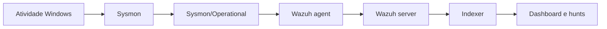

# Integração entre Sysmon e Wazuh

## Fluxo esperado

## Responsabilidades

- **Sysmon:** observa e filtra telemetria local.
- **Windows Event Log:** persiste os eventos.
- **Wazuh agent:** coleta o canal e envia os registros.
- **Wazuh server:** decodifica, correlaciona e aplica regras.
- **Indexer/dashboard:** armazenam e permitem pesquisa e visualização.

## Critérios de validação

1. O evento existe no canal local.
2. O agente está ativo e configurado para coletar o canal.
3. O evento chega com Event ID, host e timestamp preservados.
4. É possível recuperar o registro original no Wazuh.
5. Uma regra, quando aplicável, é testada separadamente da coleta.

Se o evento não aparece localmente, investigue o XML e o Sysmon. Se aparece localmente, mas não no Wazuh, investigue coleta e transporte. Essa separação evita modificar uma detecção para compensar telemetria ausente.
